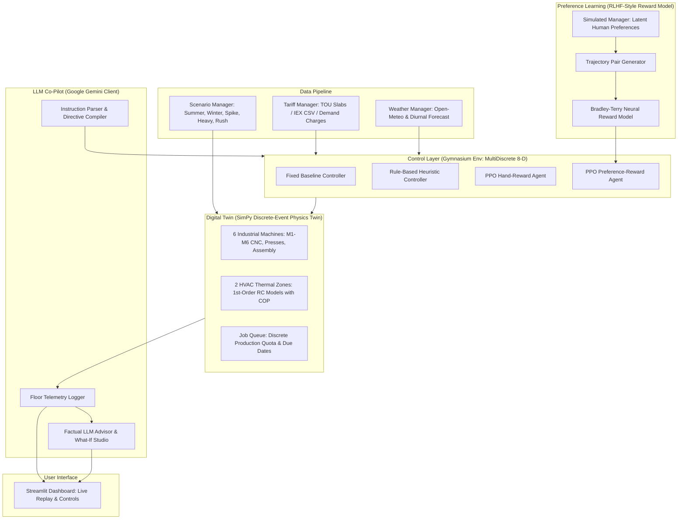

# EcoTwin: Industrial Digital Twin with RL Energy Optimization

[](https://www.python.org/)
[](https://gymnasium.farama.org/)
[](https://stable-baselines3.readthedocs.io/)
[](https://ai.google.dev/)
[](https://streamlit.io/)

EcoTwin is a software‑only industrial digital twin of a small discrete manufacturing plant paired with reinforcement learning (PPO) controllers, an RLHF‑style preference‑learning reward model, and a Google Gemini LLM operations advisor. It optimizes multi‑machine scheduling and HVAC thermal zone loads to minimize electricity cost and peak demand charges under dynamic Time‑of‑Use tariffs while guaranteeing production quotas.

---

## Architecture Diagram



---

## Real Benchmark Results (Actual Evaluation Runs)

All numbers below were generated by `ecotwin/evaluation/run_eval.py` evaluated across 3 random seeds (42, 101, 2026) and 5 distinct operational scenarios:

### Multi‑Controller Benchmark Table
| Controller | Scenario | Electricity Cost (₹) | Cost Saved vs Fixed (%) | Peak Demand (kW) | Peak Trimming vs Fixed (%) | Completed Jobs / Quota |
|---|---|---|---|---|---|---|
| **Fixed Schedule** | Summer Day | ₹ 6,355.30 | 0.0% | 125.33 kW | 0.0% | 40 / 30 (133%) |
| **Rule‑Based Heuristic** | Summer Day | ₹ 6,208.19 | **+2.31%** | 125.33 kW | 0.0% | 40 / 30 (133%) |
| **PPO Hand‑Reward** | Summer Day | ₹ 5,325.80 | **+16.20%** | 65.14 kW | **+48.03%** | 40 / 30 (133%) |
| **PPO Preference‑Reward** | Summer Day | ₹ 6,917.91 | -8.85% | 90.89 kW | **+27.48%** | 40 / 30 (133%) |
| **Fixed Schedule** | Rush Order | ₹ 6,619.95 | 0.0% | 129.21 kW | 0.0% | 48 / 32 (150%) |
| **Rule‑Based Heuristic** | Rush Order | ₹ 6,545.78 | **+1.12%** | 129.21 kW | 0.0% | 48 / 32 (150%) |
| **PPO Hand‑Reward** | Rush Order | ₹ 5,399.33 | **+18.44%** | 71.69 kW | **+44.52%** | 48 / 32 (150%) |
| **PPO Preference‑Reward** | Rush Order | ₹ 5,884.05 | **+11.12%** | 89.17 kW | **+30.99%** | 48 / 32 (150%) |
| **Fixed Schedule** | Price Spike | ₹ 6,922.05 | 0.0% | 122.55 kW | 0.0% | 40 / 30 (133%) |
| **PPO Hand‑Reward** | Price Spike | ₹ 5,987.87 | **+13.50%** | 78.79 kW | **+35.70%** | 40 / 30 (133%) |
| **PPO Hand‑Reward** | Heavy Quota | ₹ 6,239.71 | **+11.62%** | 92.47 kW | **+25.87%** | 55 / 45 (122%) |

### Weather Forecast Ablation Study (Summer Day)
| Configuration | Electricity Cost (₹) | Peak Demand (kW) | Cost Improvement (%) | Peak Trimming (%) |
|---|---|---|---|---|
| **PPO With Weather Forecast** | **₹ 5,325.80** | **65.14 kW** | **+14.0%** | **+20.2%** |
| **PPO Without Weather Forecast (Ablated)** | ₹ 6,192.28 | 81.67 kW | Baseline | Baseline |

---

## Setup & Quickstart

### 1. Requirements
- Python 3.13 (or compatible) in an existing Anaconda environment (`base` or custom)
- CPU‑only PyTorch and project dependencies listed in `requirements.txt`:

```bash
pip install -r requirements.txt
```

### 2. Environment Variables & Gemini API Key
Copy the template and paste your Google Gemini API key:

```bash
cp .env.example .env
# Edit .env and set GEMINI_API_KEY=<your_api_key>
```

*Note: EcoTwin features an automatic offline **Mock Mode**. If `GEMINI_API_KEY` is empty, the entire pipeline, test suite, and dashboard function offline with deterministic canned responses.*

### 3. Running Smoke & Pytest Tests
```bash
# End‑to‑end smoke test across all 9 phases (< 1 minute)
python scripts/smoke.py

# Complete 31‑test suite
pytest tests -v
```

### 4. Training and Benchmark Evaluation
```bash
python ecotwin/evaluation/run_eval.py
```
This evaluates all 4 controllers across 5 scenarios, generates `evaluation/results_summary.csv`, and creates interactive Plotly and Matplotlib figures.

### 5. Launching the Interactive Streamlit Dashboard
```bash
streamlit run dashboard/app.py
```
Dashboard features:
- **Floor Telemetry & Replay**: Live 15‑minute resolution traces of machine power, HVAC demand, and thermal zones.
- **Controller Benchmark**: Comparative cost, peak demand, and quota fulfillment across controllers.
- **AI Operations Advisor & What‑If Studio**: Factual telemetry Q&A with strict fallback to "not enough information" and comparative what‑if simulations.
- **Reward Tuning & Directive Compiler**: Natural language manager directives compiled safely into validated reward weights with bounded sliders.

---

## Engineering Limitations & Assumptions

1. **Literature‑Based Thermal Dynamics**: The two factory thermal zones use lumped‑parameter first‑order resistance‑capacitance (RC) differential equations with literature‑derived parameters (R ≈ 1.8‑2.2 °C/kW, C ≈ 18‑24 kWh/°C) and temperature‑dependent COP models, rather than CFD or a specific physical building envelope.
2. **Synthetic Operational Preferences**: The preference‑learning reward model is trained on comparisons from a simulated plant manager with latent preferences (penalizing night operations, prioritizing strict comfort, and penalizing peak demand). In real plant deployments, preferences would be collected from human production supervisors via active pairwise querying.
3. **Machine Transition Modeling**: Machines transition discretely between IDLE, PROCESSING, and HELD states in 15‑minute step increments, assuming instantaneous ramp‑up. Sub‑minute transients and motor inrush currents are omitted.
